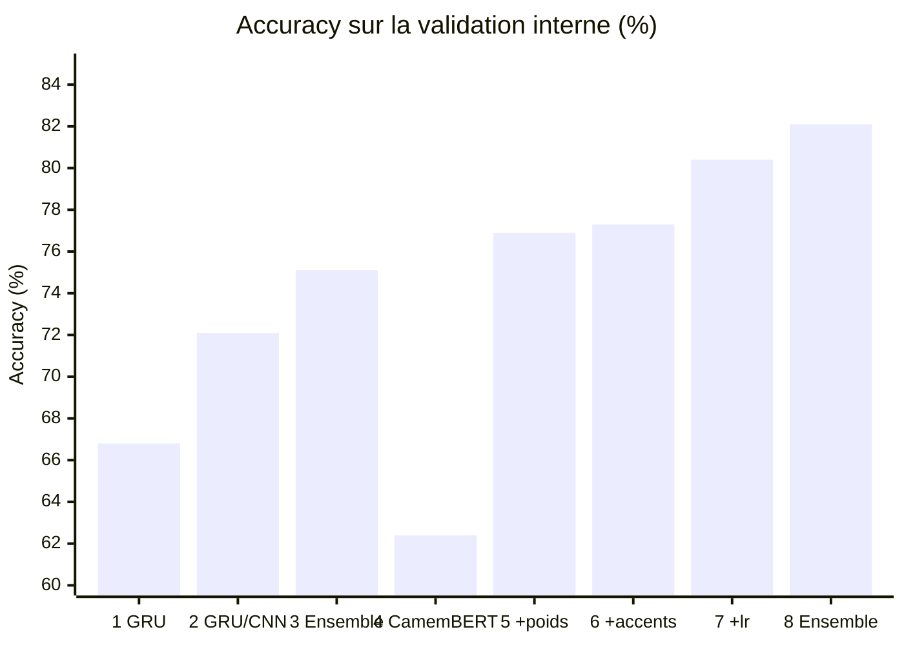

# Posos — classification d'intentions de questions médicales

Solution au [challenge Posos](https://challengedata.ens.fr/participants/challenges/17/)
(Challenge Data, ENS) : pour chaque question en français sur un médicament, prédire
l'intention de la personne parmi **51 catégories** (métrique : *accuracy*).

> « Est-ce qu'il existe une forme adaptée aux enfants de 5 ans du Micropakine ? » → intention 44
> « laroxyl à doses faibles pour le stress ? » → intention 31

🏆 **Prix Challenge Data 2018 — Meilleur participant** du challenge *Predict the
expected answer!* proposé par Posos.

  

## Contexte

Plus de 6 000 médicaments sont commercialisés en France, et leur mauvais usage cause
plus de 144 000 hospitalisations par an. Patients comme professionnels de santé
posent chaque année des millions de questions sur les médicaments. Les types de
question sont en nombre limité (effets secondaires, composition,
contre-indications, posologie…), mais une même question peut se formuler de
mille façons. Comprendre **quelle information la personne attend** est la première
étape pour lui répondre.

- **Entrée** : 8 028 questions d'entraînement en français, souvent écrites
  rapidement (fautes, abréviations, absence d'accents), et 2 035 questions de test.
- **Sortie** : l'identifiant anonymisé de l'intention (0 à 50).
- **Benchmark de Posos** : un CNN au niveau des mots (vecteurs de dimension 128,
  filtres de taille 3, 4 et 5, max-pooling, dropout 0,5), annoncé à 82 % sur un
  jeu de 10 000 exemples. Les organisateurs suggéraient de pré-entraîner les
  vecteurs de mots sur un plus grand corpus (word2vec) ou de détecter des
  propriétés comme les noms de médicaments.

## Résultats

Score officiel calculé par la plateforme sur le jeu de test (labels non publics) :

| Version | Approche | Score test |
|---|---|---|
| 2019 | Ensemble de 6 réseaux GRU / CNN sur embeddings word2vec | 0,7583 |
| 2026 | CamemBERT fine-tuné (un seul modèle) | 0,7898 |
| **2026** | **Ensemble de 3 CamemBERT** (base, bio, v2) | **0,8124** |
| *Référence* | *Benchmark de Posos (CNN)* | *0,8291* |

Un seul transformer pré-entraîné en français fait déjà mieux que l'ensemble de 2019 ;
la moyenne de trois variantes de CamemBERT gagne encore 2,3 points.
[Classement public](https://challengedata.ens.fr/participants/challenges/17/ranking/public)

## Évolution

Chaque étape, avec l'accuracy sur la validation interne (choix des réglages) et,
quand l'étape a été soumise, le score officiel sur le test.

| # | Année | Étape | Validation | Test |
|---|---|---|---|---|
| 1 | 2019 | Un réseau GRU, texte nettoyé, embeddings word2vec | ≈ 66,8 % | |
| 2 | 2019 | Réseaux GRU / CNN réglés, embeddings frWac et Wikipédia mélangés à un word2vec entraîné sur le corpus | 68,7 – 72,1 % | |
| 3 | 2019 | Ensemble pondéré de 6 modèles | ≈ 75,1 % | **0,7583** |
| 4 | 2026 | CamemBERT-base, 4 epochs, texte brut | 62,4 % | |
| 5 | 2026 | + 8 epochs, perte pondérée par classe | 76,9 % | |
| 6 | 2026 | + corrections orthographe/accents (dictionnaire de 2019) | 77,3 % | |
| 7 | 2026 | + learning rate 5e-5 au lieu de 2e-5 | 80,4 % | 0,7898 |
| 8 | 2026 | Ensemble : CamemBERT-base + CamemBERT-bio (médical) + CamemBERTv2 | 82,1 % | **0,8124** |

Les validations de 2019 (10 % des données) et de 2026 (15 %) ne portent pas sur
les mêmes questions : seules les colonnes « Test » se comparent directement. Pour
l'étape 2, le graphique montre le meilleur modèle seul.

## Contenu du dépôt

| Dossier | Contenu |
|---|---|
| [`camembert/`](camembert/) | Version actuelle : fine-tuning de CamemBERT (PyTorch / 🤗 Transformers) |
| [`2019_keras/`](2019_keras/) | Version d'origine (Keras, 2019), conservée telle quelle |

## Ce qui a changé entre 2019 et 2026

- **Modèle** : les embeddings word2vec et les réseaux GRU/CNN entraînés de zéro sont
  remplacés par [CamemBERT](https://huggingface.co/almanach/camembert-base), déjà
  pré-entraîné sur du français, puis fine-tuné sur les 8 028 questions.
- **Prétraitement** : en 2019, le texte était mis en minuscules, la ponctuation, les
  chiffres et les mots vides étaient retirés. Or des mots comme *pendant*, *avant*,
  *après* ou *avec* portent justement l'intention (« pendant la grossesse », « avec de
  l'alcool »). On garde désormais le texte intact et on applique seulement le
  dictionnaire de corrections orthographiques et d'accents constitué en 2019
  (1 861 entrées, par ex. *gelules* → *gélules*).
- **Évaluation** : une validation stratifiée de 15 % sert à choisir les réglages ;
  le modèle final est ensuite réentraîné sur toutes les données.
- **Ensemble** : comme en 2019, moyenner des modèles qui se trompent différemment
  paie. CamemBERT-bio (pré-entraîné sur des textes biomédicaux) et CamemBERTv2
  sont chacun meilleurs que CamemBERT-base, et leur moyenne avec lui corrige
  environ 20 erreurs de plus sur la validation.
- **Réglages qui ont compté** : un learning rate de 5e-5 au lieu de 2e-5 (+3 points
  en validation) et une perte pondérée par classe, les 51 intentions étant très
  déséquilibrées (une classe couvre 22 % des questions).

Les données du challenge ne sont pas redistribuées ici : elles sont disponibles sur
le site du challenge après inscription.
