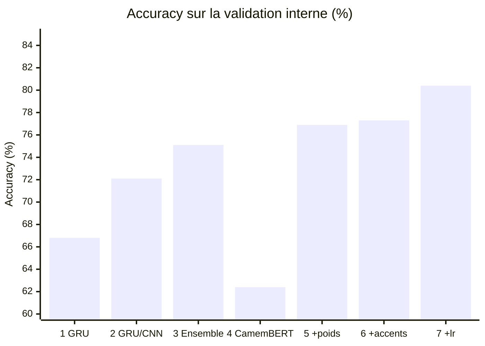

# Posos — classification d'intentions de questions médicales

Solution au [challenge Posos](https://challengedata.ens.fr/participants/challenges/17/)
(Challenge Data, ENS) : pour chaque question en français sur un médicament, prédire
l'intention de la personne parmi **51 catégories** (métrique : *accuracy*).

> « Est-ce qu'il existe une forme adaptée aux enfants de 5 ans du Micropakine ? » → intention 44
> « laroxyl à doses faibles pour le stress ? » → intention 31

🏆 **Prix Challenge Data 2018 — Meilleur participant** du challenge *Predict the
expected answer!* proposé par Posos.

  

## Résultats

Score officiel calculé par la plateforme sur le jeu de test (labels non publics) :

| Version | Approche | Score test |
|---|---|---|
| 2019 | Ensemble de 6 réseaux GRU / CNN sur embeddings word2vec | 0,7583 |
| **2026** | **CamemBERT fine-tuné** (un seul modèle) | **0,7898** |

Un seul transformer pré-entraîné en français fait mieux que l'ensemble de 2019,
avec un code bien plus court.
[Classement public](https://challengedata.ens.fr/participants/challenges/17/ranking/public)

## Évolution

Chaque étape, avec l'accuracy sur la validation interne (choix des réglages) et,
quand l'étape a été soumise, le score officiel sur le test.

| # | Année | Étape | Validation | Test |
|---|---|---|---|---|
| 1 | 2019 | Un réseau GRU, texte nettoyé, embeddings word2vec | ≈ 66,8 % | |
| 2 | 2019 | Réseaux GRU / CNN réglés, embeddings frWac et Wikipédia mélangés à un word2vec entraîné sur le corpus | 68,7 – 72,1 % | |
| 3 | 2019 | Ensemble pondéré de 6 modèles | ≈ 75,1 % | **0,7583** |
| 4 | 2026 | CamemBERT-base, 4 epochs, texte brut | 62,4 % | |
| 5 | 2026 | + 8 epochs, perte pondérée par classe | 76,9 % | |
| 6 | 2026 | + corrections orthographe/accents (dictionnaire de 2019) | 77,3 % | |
| 7 | 2026 | + learning rate 5e-5 au lieu de 2e-5 | 80,4 % | **0,7898** |

Les validations de 2019 (10 % des données) et de 2026 (15 %) ne portent pas sur
les mêmes questions : seules les colonnes « Test » se comparent directement. Pour
l'étape 2, le graphique montre le meilleur modèle seul.

## Contenu du dépôt

| Dossier | Contenu |
|---|---|
| [`camembert/`](camembert/) | Version actuelle : fine-tuning de CamemBERT (PyTorch / 🤗 Transformers) |
| [`2019_keras/`](2019_keras/) | Version d'origine (Keras, 2019), conservée telle quelle |

## Ce qui a changé entre 2019 et 2026

- **Modèle** : les embeddings word2vec et les réseaux GRU/CNN entraînés de zéro sont
  remplacés par [CamemBERT](https://huggingface.co/almanach/camembert-base), déjà
  pré-entraîné sur du français, puis fine-tuné sur les 8 028 questions.
- **Prétraitement** : en 2019, le texte était mis en minuscules, la ponctuation, les
  chiffres et les mots vides étaient retirés. Or des mots comme *pendant*, *avant*,
  *après* ou *avec* portent justement l'intention (« pendant la grossesse », « avec de
  l'alcool »). On garde désormais le texte intact et on applique seulement le
  dictionnaire de corrections orthographiques et d'accents constitué en 2019
  (1 861 entrées, par ex. *gelules* → *gélules*).
- **Évaluation** : une validation stratifiée de 15 % sert à choisir les réglages ;
  le modèle final est ensuite réentraîné sur toutes les données.
- **Réglages qui ont compté** : un learning rate de 5e-5 au lieu de 2e-5 (+3 points
  en validation) et une perte pondérée par classe, les 51 intentions étant très
  déséquilibrées (une classe couvre 22 % des questions).

Les données du challenge ne sont pas redistribuées ici : elles sont disponibles sur
le site du challenge après inscription.
